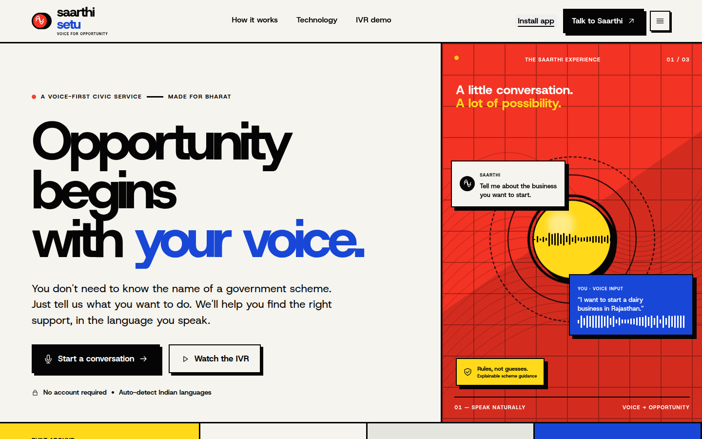
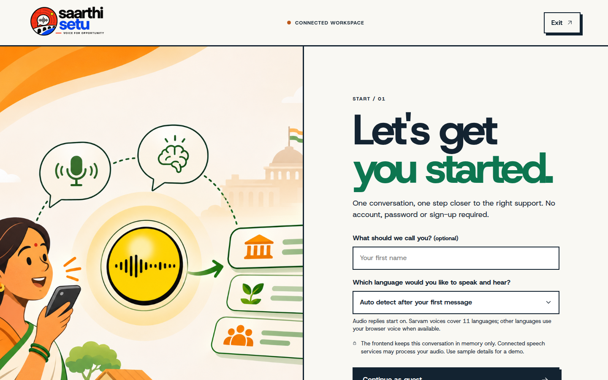
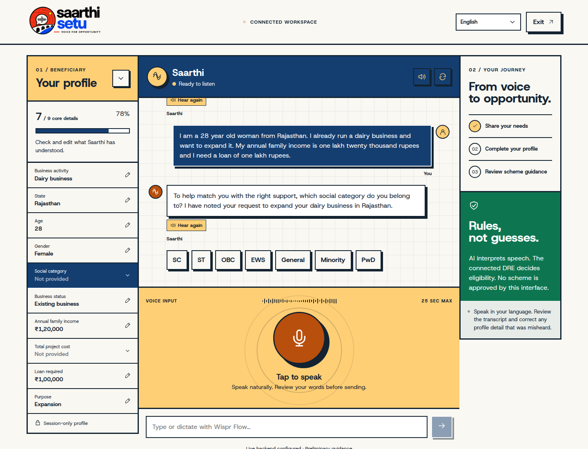
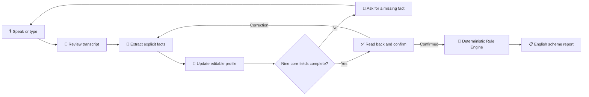
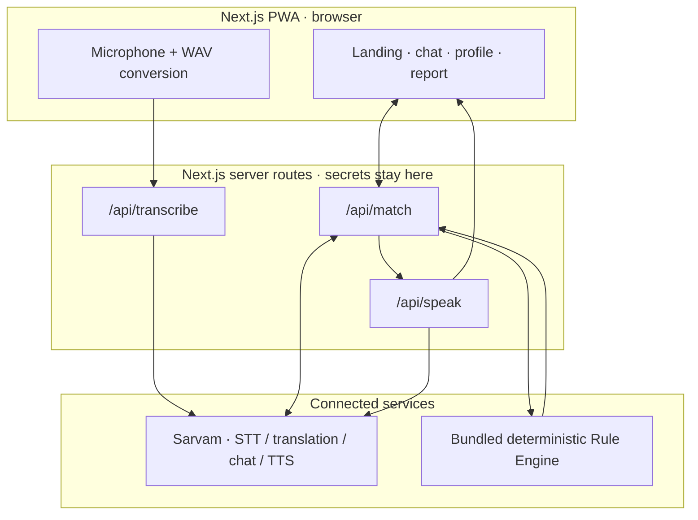

<div align="center">
  
  <h1>Saarthi Setu</h1>
  <p><strong>Your voice. Your opportunity.</strong></p>
  <p>A multilingual, voice enabled guide from a person's business story to a reviewable government scheme report.</p>
  <p>
    
    
  </p>
  <p><a href="#-the-problem">The problem</a> · <a href="#-the-solution">The solution</a> · <a href="#-how-it-works">How it works</a> · <a href="#-run-the-prototype">Run it</a> · <a href="#-evaluate-it-in-3-minutes">Judge's walkthrough</a></p>
</div>



> [!IMPORTANT]
> **Hackathon scope:** Saarthi Setu offers *preliminary scheme discovery*. It does not submit applications, sanction loans, or guarantee eligibility. Current scheme rules, documents and application channels must be checked with official institutions.

## 🎯 The problem

**AI-Driven Scheme Matching for Marginalized Entrepreneurs.** The challenge is to make government support discoverable for people who may know their business needs but not a scheme's name, eligibility wording, or application path.

A prospective entrepreneur may say, “I run a dairy business in Rajasthan and need a loan,” yet the information needed for matching is scattered across a conversation: age, category, income, project cost, loan need and whether the business already exists. A long form, an English-only search box, or a list of scheme names puts that burden on the applicant. A recommendation without a clear reason or next steps is hard to trust and act on.

| Barrier | What Saarthi changes |
| --- | --- |
| **Language and literacy** | Speak naturally, review the transcript, and hear the assistant's reply. |
| **Unknown scheme names** | Start with the business need; the system asks for missing profile facts. |
| **Fragmented answers** | Facts from the ongoing conversation fill an editable profile panel. |
| **Unclear eligibility** | A deterministic Rule Engine evaluates the profile; AI does not decide eligibility. |
| **No next step** | The English report groups documents and shows a stage-by-stage application path. |

## ✨ The solution

Saarthi Setu turns a conversation into a structured, **user-confirmed** profile, then runs that profile through the bundled Rule Engine. The visitor can use voice or text and can correct any field before seeing matches.

<div align="center">

**Speak → Review transcript → Build profile → Confirm facts → Check rules → Follow the report**

</div>

### What works in this prototype

- 🎙️ **Voice input:** browser recording is converted to mono 16 kHz WAV and sent to Sarvam Saaras v4 for speech-to-text. The user reviews or edits the transcript before sending it.
- 🌐 **Multilingual chat:** the visitor chooses a language or uses automatic detection. Sarvam handles translation, language interpretation and conversational replies. Sarvam Bulbul v4 Flash speaks replies in its supported languages; a browser voice is used when available for others.
- 🧠 **Conversation memory:** explicit facts from earlier user messages can fill missing profile fields. New corrections take priority over older statements. The left panel shows the current understanding and supports manual edits.
- ✅ **Confirmation gate:** all nine core fields must be present. Saarthi reads back the details and waits for confirmation; corrections return to this step. Scheme results remain hidden until confirmation.
- 📐 **Rule-based matching:** the bundled Rule Engine checks eligibility rules, ranks matches and prepares document guidance. The report displays only results the engine marks `ELIGIBLE`.
- 🧭 **Actionable report:** a printable English report shows profile amounts, rule-checked schemes, documents, official-source links when supplied, and a stage-by-stage path.
- 📱 **Guest-first PWA:** responsive interface, no sign-up, and no database for the web conversation.

**Guest entry:** choose a language, or let Saarthi detect it from the first message.



**Live conversation:** explicit facts update the editable profile beside the central microphone.



## 🔁 How it works



### Internal request path

| Step | Component | What it does |
| --- | --- | --- |
| 1 | **Browser · `components/Workspace.jsx`** | Records a short clip or accepts typed text; keeps conversation state in memory. |
| 2 | **Browser audio · `lib/recording-audio.mjs`** | Converts the recording to mono 16 kHz WAV for reliable upload. |
| 3 | **STT · `/api/transcribe`** | Sends audio to Sarvam Saaras v4 and returns the transcript and detected language. |
| 4 | **Conversation · `/api/match`** | Translates the latest message to English, considers earlier user messages, extracts explicit facts, and applies corrections to the profile. |
| 5 | **Profile gate · `/api/match`** | Checks the nine core fields. Once complete, returns `CONFIRM_PROFILE` with no schemes until the user confirms. |
| 6 | **Rule Engine · `services/rule-engine`** | Validates the confirmed profile; evaluates scheme rules, scores eligible results and generates document guidance. |
| 7 | **Response · `/api/match` + `/api/speak`** | Composes a conversational reply, localizes it, and plays Sarvam Bulbul audio when supported. |
| 8 | **Report · `components/Report.jsx`** | Displays eligible matches, document groups and application stages; browser print saves it as a PDF. |



**Design boundary:** Sarvam interprets what the visitor said and how to reply. The Rule Engine decides which catalog entries satisfy their encoded conditions. The UI filters to `ELIGIBLE` results and labels the outcome as preliminary guidance.

### Profile and confirmation state

The nine core fields are **business activity, state, age, gender, social category, existing/new business, annual family income, total project cost and requested loan**. Purpose can be captured as an additional detail. The visitor can edit any visible field. A loan greater than the stated project cost triggers clarification before matching.

| State | Visitor sees | Next action |
| --- | --- | --- |
| Missing facts | Updated left profile panel and one follow-up question | Speak, type or edit a field |
| `CONFIRM_PROFILE` | Summary of learned details; no schemes | Confirm or correct |
| Confirmed | Rule-checked matches and report | Review documents and official sources |
| No eligible match | Honest empty result | Recheck the profile or seek authorized assistance |

## 🚀 Run the prototype

### Docker Compose · one command

With Docker installed, run this from the repository root:

```bash
docker compose up --build
```

Open **http://localhost:3000/**. The root `docker-compose.yml` starts the Next.js website and bundled Rule Engine, waits for the engine to become healthy, and publishes the website on port `3000`. No `.env` file or API key is needed to build and see the main screen. Live Sarvam chat and transcription show a clear key-not-set message until configured.

To enable live speech and AI interpretation, copy `.env.example` to `.env`, fill `SARVAM_API_KEY`, and run the same command again. The key stays out of Git. If port `3000` is occupied, set `SAARTHI_PORT` in `.env` to another host port and open that port instead.

### Run without Docker

**Requirements:** Node.js 20.9+, npm, a modern microphone-capable browser, and a Sarvam API key for the live speech and chat flow. Microphone access needs localhost or HTTPS.

```bash
npm run setup:all
cp .env.example .env.local
```

Fill `SARVAM_API_KEY` in `.env.local`, then start both bundled services:

```bash
npm run dev:all
```

Open **http://127.0.0.1:8080/assistant**. The Next.js app runs on port `8080`; the Rule Engine runs on port `3000`. For a production build, run `npm run build` followed by `npm run start:all`.

The example environment already sets `NEXT_PUBLIC_MATCH_URL=/api/match`, `NEXT_PUBLIC_TRANSCRIBE_URL=/api/transcribe` and `RULE_ENGINE_URL=http://127.0.0.1:3000/api/v1/match`. Keep `SARVAM_API_KEY` server-side; never give it a `NEXT_PUBLIC_` prefix. If changing ports, set `WEB_PORT` and `RULE_ENGINE_PORT` in the shell and update `RULE_ENGINE_URL`. A temporary HTTPS demo can be shared with `ngrok http 8080`.

> [!TIP]
> Without a Sarvam key, the app still starts and shows its main screen. Live speech and AI interpretation show a key-not-set message. The repository contains `.env.example` only; local secrets are ignored by Git.

## 🧪 Evaluate it in 3 minutes

1. Open `/assistant`, choose **English**, **Hindi** or another available language, then continue as a guest.
2. Speak or paste this sample: “I am a 28-year-old woman from Rajasthan. I run a dairy business and want to expand it. My annual family income is ₹1,20,000 and I need a ₹1,00,000 loan.”
3. Watch the **left profile panel** fill from the conversation. Provide the missing social category and project cost when Saarthi asks. Try correcting a field to see the panel update.
4. Check the **read-back confirmation**. Correct a detail or press **Confirm details and see schemes**.
5. Inspect the **rule-checked report**, document checklist, application stages and printable output. Try **Hear again** for a spoken reply.

**Expected behavior:** The report cannot appear before the nine core fields are complete and confirmed. It should show only results returned as eligible by the Rule Engine. The exact matches depend on the profile and the bundled scheme catalog.

## 🗂️ Repository map

| Path | Responsibility |
| --- | --- |
| [`app/`](app/) | Next.js routes, page shell and same-origin server APIs |
| [`components/`](components/) | Landing page, chat workspace, language picker and report |
| [`lib/`](lib/) | Profile display and validation helpers, API adapter and audio conversion |
| [`services/rule-engine/`](services/rule-engine/) | Bundled scheme catalog, eligibility engine, scoring, documents and REST service |
| [`scripts/run-all.mjs`](scripts/run-all.mjs) | Starts the web app and Rule Engine together |
| [`tests/`](tests/) | Web integration logic checks |

The IVR prototype is a separate channel and is **not required** to run this web experience. The bundled Rule Engine has its own [technical README](services/rule-engine/README.md) and [integration notes](services/rule-engine/integrate.md).

## ✅ Verification and honest scope

```bash
npm test
npm test --prefix services/rule-engine
npm run build
```

At the time of this update, the web suite has **7 passing tests** and the bundled Rule Engine has **18 passing tests**. The complete bundle has also been started on separate ports and checked through its health and assistant routes.

- **Working:** turn-based microphone capture, Sarvam transcription, multilingual conversation, editable profile, confirmation gate, deterministic matching, spoken replies and an English report.
- **Prototype limits:** voice turns are recorded and sent, not a continuous low-latency phone-style stream; browser playback support varies; the web session is not persisted after exit.
- **Before public deployment:** independently verify scheme data, current eligibility rules, official links, documents and lending terms; add production monitoring, rate limits and a formal privacy/retention policy.

<div align="center">
  <strong>One conversation. A clearer next step.</strong><br/>
  <sub>Saarthi Setu · Voice for opportunity</sub>
</div>
